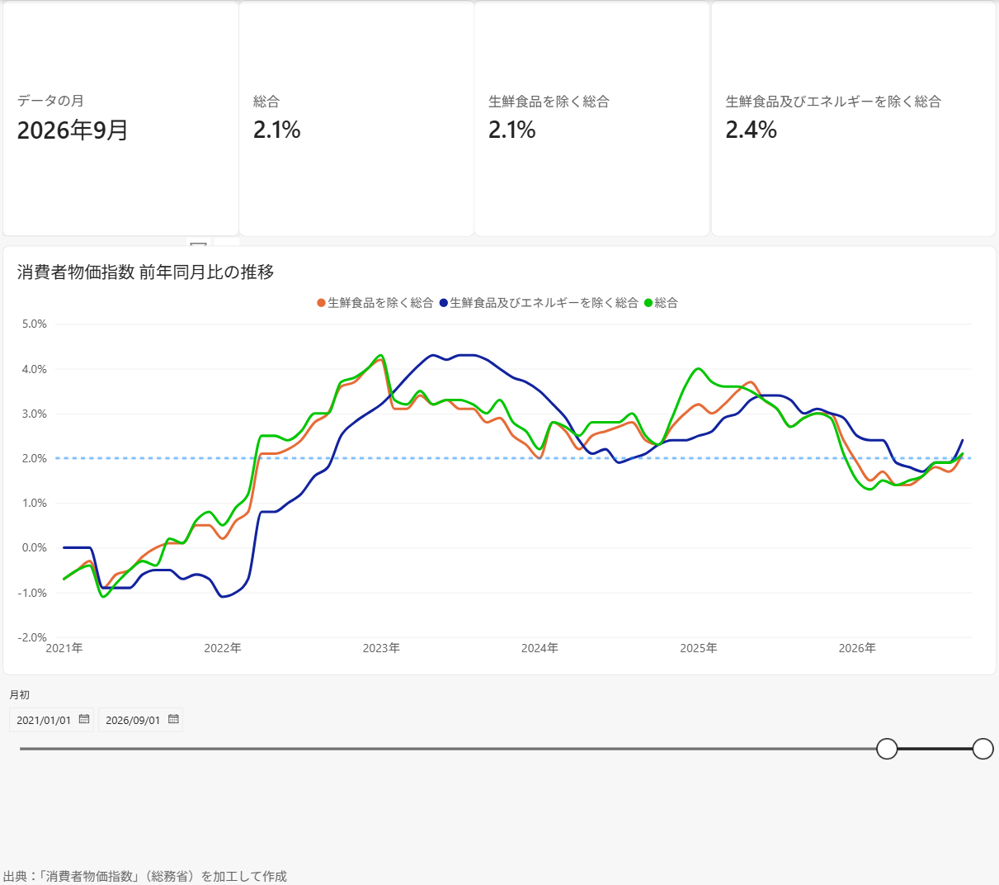
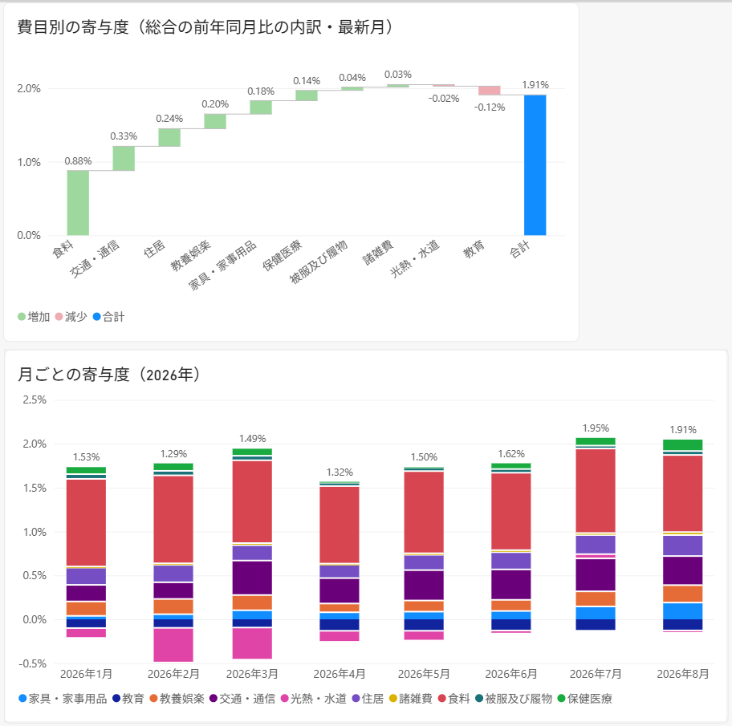
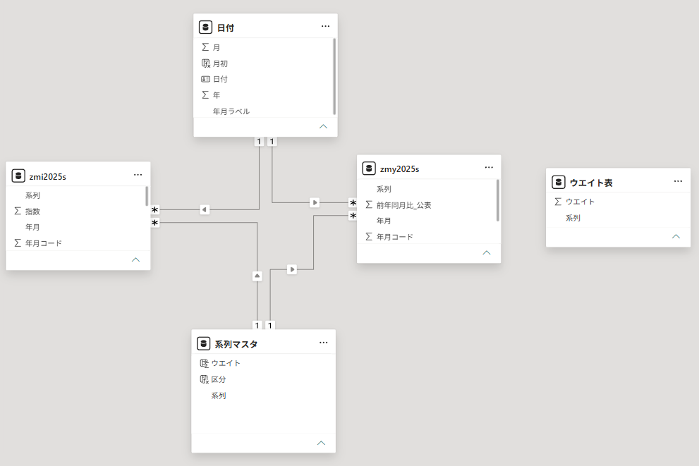

# 消費者物価指数（CPI）ダッシュボード

総務省「消費者物価指数」（2025年基準・全国・月次）を使って、物価上昇率の推移と、その内訳（どの費目が上昇率を押し上げたか）を可視化した Power BI ダッシュボードです。

個人の学習として作成しました。公開されている政府統計のみを使用しています。

## 画面

### 1. 物価の全体像



- 最新月の前年同月比を3つの指標（総合／生鮮食品を除く総合／生鮮食品及びエネルギーを除く総合）で表示
- 2021年以降の前年同月比の推移を折れ線で表示し、目安として2%の線を表示
- 期間はスライサーで変更可能

### 2. 何が物価を動かしたか



- 最新月（2026年8月）の総合の前年同月比を、10大費目の寄与度に分解（ウォーターフォール図）
- 2026年1月〜8月の寄与度の月次推移（積み上げ縦棒）

### 読み取れること（2026年8月分）

- 総合の前年同月比1.9%のうち、食料の寄与が0.88ポイントで約半分を占める
- 教育（−0.12ポイント）と光熱・水道（−0.02ポイント）は押し下げ方向に寄与
- 2026年2月から8月にかけての上昇率の拡大は、主に光熱・水道のマイナス寄与の縮小（約−0.40 → −0.02ポイント）によるもので、交通・通信、家具・家事用品の寄与拡大も加わっている

## データ

| ファイル | 内容 | 期間 |
| --- | --- | --- |
| `zmi2025s.csv` | 中分類指数（全国・月次、2025年=100） | 1970年1月〜2026年8月 |
| `zmy2025s.csv` | 中分類指数の前年同月比（公表値、%） | 同上 |
| `zmi2025b.csv` | 財・サービス分類指数（全国・月次、2025年=100）。現在のダッシュボードでは未使用 | 同上 |

- 取得元：e-Stat（政府統計の総合窓口）
  - zmi2025s.csv：https://www.e-stat.go.jp/stat-search/file-download?statInfId=000040482943&fileKind=1
  - zmy2025s.csv：https://www.e-stat.go.jp/stat-search/file-download?statInfId=000040482953&fileKind=1
  - zmi2025b.csv：https://www.e-stat.go.jp/stat-search/file-download?statInfId=000040482946&fileKind=1
- 文字コードは Shift_JIS（cp932）。先頭6行が見出し（系列名、英語名、符号、連番、ウエイト、ウエイト1万分比）で、7行目以降が年月ごとの値
- 2025年基準より前の期間は、接続指数（基準年の異なる指数を2025年=100に接続したもの）

出典：「消費者物価指数」（総務省）（https://www.stat.go.jp/data/cpi/）を加工して作成

## データモデル



日付と系列（費目）を軸にしたスタースキーマです。

| テーブル | 種類 | 内容 |
| --- | --- | --- |
| `zmi2025s` | ファクト | 年月 × 系列の指数（52,188行） |
| `zmy2025s` | ファクト | 年月 × 系列の前年同月比・公表値（51,264行） |
| `日付` | ディメンション | 1970年1月1日〜最新月末の日付テーブル（日付テーブルとしてマーク） |
| `系列マスタ` | ディメンション | 78系列。ウエイト（1万分比）と区分（10大費目／その他）を持つ |
| `ウエイト表` | 補助 | CSVのウエイト行から作成。`系列マスタ[ウエイト]` の参照元 |

- リレーションシップはすべて一対多・単方向
- 自動の日付/時刻は無効化

### Power Query での主な整形

1. CSV（cp932）を読み込み、1行目を見出しに昇格
2. 符号・連番・ウエイトなどの見出し行（5行）を削除
3. 系列の列をピボット解除して「年月コード／系列／指数」の縦持ちに変換
4. 年月コード（例：202608）から月初日の日付列を作成
5. 値が空の行を削除（未公表の期間がある系列を除くため）

CSVの保存先はパラメーター `DataFolder` で指定しています。

## 主なメジャー

| メジャー | 内容 |
| --- | --- |
| 指数（値） | 系列が1つに絞られているときの指数 |
| 前年同月比 | 指数から計算した前年同月比（当月指数 ÷ 前年同月指数 − 1） |
| 前年同月比（公表） | e-Stat 公表の前年同月比（%を小数に変換） |
| 最新月 | データが存在する最新の年月（日付の絞り込みを無視） |
| 寄与度 | 総合の前年同月比に対する各費目の寄与（下記） |

寄与度は、総務省の寄与度の考え方に沿って次の式で計算しています。

```
寄与度 = (当月の費目指数 − 前年同月の費目指数) × 費目ウエイト / 10000 ÷ 前年同月の総合指数
```

```dax
寄与度 =
VAR W = SELECTEDVALUE('系列マスタ'[ウエイト])
VAR CurIdx = [指数（値）]
VAR PrevIdx = CALCULATE([指数（値）], SAMEPERIODLASTYEAR('日付'[日付]))
VAR PrevTotal =
    CALCULATE(
        [指数（値）],
        SAMEPERIODLASTYEAR('日付'[日付]),
        REMOVEFILTERS('系列マスタ'),
        '系列マスタ'[系列] = "総合"
    )
RETURN
    IF(
        NOT ISBLANK(CurIdx) && NOT ISBLANK(PrevIdx) && NOT ISBLANK(W),
        DIVIDE((CurIdx - PrevIdx) * W / 10000, PrevTotal)
    )
```

グラフの合計表示には、系列ごとに計算した寄与度を `SUMX(VALUES('系列マスタ'[系列]), [寄与度])` で足し上げています。

## 検算

| 確認内容 | 結果 |
| --- | --- |
| 指数テーブルの行数・月数 | 52,188行、680か月（1970年1月〜2026年8月） |
| 日付テーブルの行数 | 20,697日 |
| 自作の前年同月比（2026年8月・78系列） | Python で同じ計算をした結果と78系列すべて一致。公表値とは58系列が一致し、残りも差は0.1ポイント以内 |
| 寄与度（2026年8月・10大費目） | Python の計算と10費目すべて一致。総務省公表の寄与度との差は0.02ポイント以内 |
| 寄与度の合計 | 2026年8月は1.91%（公表の総合1.9%と整合）。2026年1月〜8月の各月合計も公表の総合の前年同月比と整合 |

## 注意点

- 寄与度は2025年基準のウエイトを使うため、当月・前年同月がともに2025年基準の指数となる2026年1月以降を対象にしています
- 自作の前年同月比は公表指数（小数第1位）から計算するため、公表値と0.1ポイント程度ずれることがあります。そのため、1ページ目のカードとグラフは公表値を表示しています
- 10大費目のウエイトの合計は四捨五入の関係で10002となり、寄与度の合計は総合の前年同月比とわずかにずれることがあります

## 開き方

1. Power BI Desktop をインストール
2. 上記のリンクからCSVを取得し、`data` フォルダーに置く
3. `cpi-dashboard.pbip` を開く
4. 「ホーム」→「データの変換」→「パラメーターの編集」で、`DataFolder` に `data` フォルダーのパスを入力（末尾に `\` を付ける）
5. 「更新」を押す

## フォルダー構成

```
cpi-dashboard/
├─ cpi-dashboard.pbip            Power BI プロジェクト
├─ cpi-dashboard.Report/         レポート定義
├─ cpi-dashboard.SemanticModel/  セマンティックモデル定義（TMDL）
├─ data/                         CSV
└─ images/                       README用の画面画像
```

## 使用ツール

- Power BI Desktop（PBIP形式、TMDL）
- Power Query（M）、DAX
- Git / GitHub（ブランチ、プルリクエストでの変更管理）
- Python（検算用）
